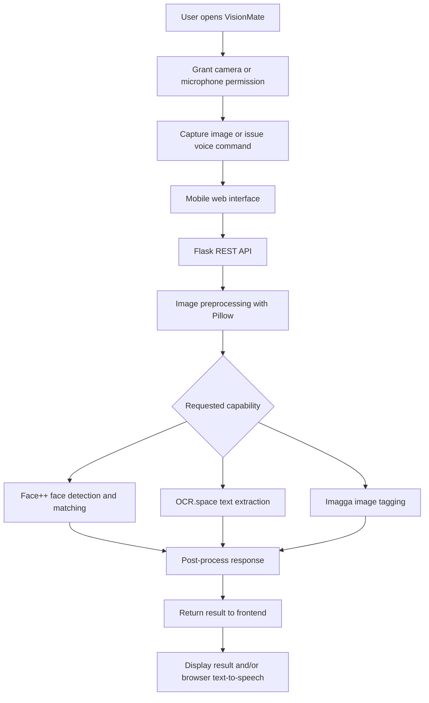

# VisionMate — AI-Powered Assistive System

<p align="center">
  <strong>An accessible, voice-guided vision assistant designed to support people with visual impairment and people who may need help recognizing familiar faces.</strong>
</p>

<p align="center">
  <a href="https://visionmate-zi3m.onrender.com/app">Live Demo</a> ·
  <a href="https://github.com/Roshni-07/VisionMate">GitHub Repository</a>
</p>

---

## Overview

VisionMate is a mobile-first assistive web application that combines camera input, cloud-based computer vision, OCR, and browser speech features to make selected visual information easier to access through spoken feedback.

Using a device camera, a user can request information about a person, read visible text, or identify objects in the surrounding scene. Voice commands and text-to-speech are intended to reduce the need to interact with small on-screen controls. The interface also includes accessibility-focused options such as high contrast, camera switching, zoom, and speech controls.

> **Important:** VisionMate is a prototype assistive tool, not a medical device, emergency service, or certified navigation system. Its output can be wrong or delayed. Do not rely on it alone to cross roads, navigate hazards, identify medication, or make safety-critical decisions.

## Live Demo

**Try VisionMate:** https://visionmate-zi3m.onrender.com/app

The hosted application may take time to respond after inactivity, and functionality can depend on third-party API availability, network access, browser permissions, and service quotas.

## Problem Statement

People with visual impairments can face barriers when trying to read printed text, recognize people, or understand objects in their immediate environment. These tasks may require assistance from another person or several separate tools. People experiencing memory-related difficulties may also benefit from support for recognizing previously registered familiar faces.

VisionMate explores how a single, voice-guided interface can bring these capabilities together in a more accessible workflow.

## Features

### 1. Face recognition support
- Capture an image using the device camera.
- Compare detected faces against registered face records using the Face++ service.
- Return a match when the service's configured matching threshold is met.
- Support scenes containing multiple detected faces, subject to API results and image quality.

### 2. Text reading with OCR
- Capture visible text with the camera.
- Use OCR.space Engine 2 to extract text from the image.
- Apply a lightweight text-cleaning filter to reduce some noisy OCR output.
- Read the extracted text aloud using browser speech synthesis.

### 3. Object and scene cues
- Send captured images to Imagga for image tagging.
- Filter tags by confidence and reduce duplicate or synonymous labels before presenting results.
- Treat the results as model-generated visual cues rather than a complete or guaranteed description of a scene.

### 4. Voice interaction
The interface includes voice-oriented workflows for actions such as:
- **“Who is this?”** — request face recognition.
- **“Read the text”** — request OCR and spoken text.
- **“What is this?”** — request object or image tags.
- **“Update person”** — access the person-update workflow.

Voice recognition and speech output depend on browser support, microphone permission, and the surrounding environment.

### 5. Accessibility controls
- High-contrast black-and-yellow visual theme.
- Front/rear camera switching where supported by the device.
- Camera zoom controls, where supported.
- Speech mute/unmute controls.
- Mobile-first layout for use on a phone-sized screen.

### 6. Person metadata storage
- SQLite is used to store application-side person metadata.
- The app includes a caregiver dashboard page in the repository.
- Dashboard behaviour and stored data should be reviewed in the application before relying on it for care workflows.

## How It Works



### Processing flow

1. The browser requests camera access and captures a frame using the camera and canvas APIs.
2. The captured image is encoded and sent to the Flask backend.
3. The backend preprocesses the image with Pillow; the implementation resizes images to a maximum of approximately 800 × 800 pixels before sending them to vision services.
4. Depending on the requested task, the backend calls Face++, OCR.space, or Imagga.
5. The backend applies task-specific post-processing and returns a response to the frontend.
6. The frontend presents the result and can read it aloud using the Web Speech API.

## Technology Stack

| Area | Technology |
|---|---|
| Backend | Python, Flask, Flask REST endpoints |
| Frontend | HTML, CSS, JavaScript |
| Face recognition | Face++ API |
| Optical character recognition | OCR.space, Engine 2 |
| Image tagging | Imagga API |
| Image processing | Pillow (PIL) |
| Local application database | SQLite |
| Voice input/output | Browser Web Speech API, where supported |
| Hosting | Render |

## Repository Structure

```text
VisionMate/
├── server.py                 # Flask backend and API workflows
├── visionmate_app.html       # Main user-facing application
├── caregiver_dashboard.html  # Caregiver dashboard interface
├── requirements.txt          # Python dependencies
├── Procfile                  # Process command for deployment
├── render.yaml               # Render deployment configuration
└── README.md                 # Project documentation
```

## Deployment

The repository includes a `Procfile` and `render.yaml` for Render deployment. To deploy your own instance:

1. Fork or connect this repository to your Render account.
2. Review the build and start commands in `render.yaml` and `Procfile`.
3. Add the required third-party API credentials as Render environment variables, using the exact names expected by `server.py`.
4. Deploy and test camera permission, API responses, and browser speech features over HTTPS.
5. Review service logs and usage limits if requests fail or the hosted service is slow to start.

Live deployment: https://visionmate-zi3m.onrender.com/app

## Design and Implementation Notes

- **Image resizing:** images are resized before external API calls to limit payload size and processing overhead.
- **OCR cleanup:** the OCR processing flow filters some low-quality lines using an alphanumeric-character ratio. This may also remove valid text in some languages or formats.
- **Face matching:** face comparison relies on the external service and the application's configured threshold. A match is not proof of identity.
- **Image tags:** tag confidence filtering and synonym deduplication help simplify returned labels, but may discard useful details or leave incorrect labels.
- **Automatic capture:** the project presentation describes a periodic auto mode. Actual timing and behaviour should be confirmed against the current code and deployment before being treated as a guaranteed feature.

## Evaluation

The project report and review materials describe target or reported evaluation figures for face recognition, OCR, object detection, and response time. These values should not be treated as independently verified benchmarks unless the test dataset, sample size, test conditions, and measurement method are published alongside them. In particular, the project materials contain differing object-detection mAP figures; no single value is stated here as a confirmed result.

For a reproducible evaluation, document:
- Dataset and number of test samples.
- Face-match precision/recall and false-accept/false-reject rates.
- OCR character or word error rate by language and image condition.
- Object-tagging evaluation method and metric.
- End-to-end latency, network conditions, and API response time.
- Accessibility testing with intended users and assistive technologies.

## Limitations

- The core vision capabilities depend on internet connectivity and third-party cloud APIs.
- External API quotas, service outages, latency, and pricing can affect availability.
- Hosted free-tier services may experience cold starts.
- Recognition and OCR quality can vary with lighting, blur, camera quality, occlusion, language, and scene complexity.
- Browser voice features vary by browser, device, language, and microphone conditions.
- Face recognition can misidentify a person and should not be treated as definitive identity verification.
- The project does not currently constitute a dedicated wearable device or a validated offline navigation solution.
- The application is a prototype and has not been established as a clinically validated dementia-care product.

## Future Scope

Potential next steps include:
- Exploring a Raspberry Pi-based wearable prototype.
- Evaluating offline or on-device inference to reduce network dependency.
- Adding multilingual OCR support, including Indian languages such as Kannada, Hindi, Tamil, and Bengali.
- Investigating spatial and depth cues for navigation support, with appropriate safety validation.
- Exploring medication reminders and richer natural-language scene descriptions.
- Migrating from SQLite to PostgreSQL if deployment and data requirements justify it.

These are proposed enhancements, not claims about current functionality.

## Social Impact

VisionMate explores assistive technology in support of:

- **SDG 3 — Good Health and Well-Being:** investigating accessible digital support for people who may experience visual or memory-related difficulties.
- **SDG 9 — Industry, Innovation and Infrastructure:** applying software, computer vision, and accessible interface design to an assistive-technology prototype.

These are areas of intended contribution; the project does not by itself demonstrate measurable SDG impact.

## Privacy and Responsible Use

VisionMate may process camera images and face-related information through third-party services. Before using it with other people, obtain appropriate consent and review the privacy terms and data-handling practices of the external providers. Do not upload sensitive images or personal information unless you understand how they may be processed. Protect API credentials, restrict access to any stored person records, and remove test data that is no longer needed.

## Acknowledgements

VisionMate uses open-source software and third-party services, including Flask, Pillow, the browser Web Speech API, Face++, OCR.space, Imagga, and Render.

---

<p align="center">
  Designed and developed independently as an assistive-technology project.
</p>
